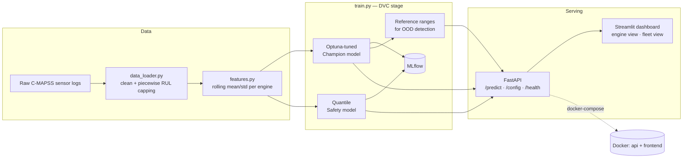

<div align="center">

# ✈️ Predictive Maintenance — NASA C-MAPSS FD001

**Remaining Useful Life (RUL) prediction for turbofan engines, served through a production API and a fleet-monitoring dashboard.**

[](https://www.python.org/)
[](https://fastapi.tiangolo.com/)
[](https://streamlit.io/)
[](https://xgboost.readthedocs.io/)
[](https://mlflow.org/)
[](https://dvc.org/)
[](https://www.docker.com/)
[](LICENSE)

[Overview](#overview) •
[Architecture](#architecture) •
[Quickstart](#quickstart) •
[API](#api) •
[Engineering highlights](#engineering-highlights) •
[Tech stack](#tech-stack)

</div>

---

## Overview

This project predicts how many operating cycles a turbofan engine has left
before failure, using NASA's C-MAPSS FD001 dataset (single operating
condition, single fault mode — the standard benchmark for RUL estimation).

Rather than a single point prediction, the system produces **two** models
and reconciles them into one operational decision:

| Model | Purpose | Technique |
|---|---|---|
| **Champion** | Best-estimate RUL | XGBoost, Optuna-tuned, scored on the asymmetric NASA/PHM08 cost function (late predictions penalized harder than early ones) |
| **Safety** | Conservative lower bound for grounding decisions | XGBoost quantile regression (`reg:quantileerror`, α = 0.1) |

The two predictions, an out-of-distribution check, and local SHAP
explanations are combined into a single maintenance recommendation
(`Normal Operation` / `Schedule Inspection` / `IMMEDIATE GROUNDING`),
served via a FastAPI backend and visualized in a Streamlit dashboard for
both single-engine inspection and fleet-wide monitoring.

## Architecture



Two architectural rules are enforced throughout the codebase:

1. **Notebooks orchestrate, `src/` implements.** Any logic used more than
   once lives in `src/` and is imported — never redefined inline, including
   in the API (`api/main.py` reuses `src/inference.py` and
   `src/evaluation.py` rather than reimplementing feature engineering).
2. **Evaluation never depends on training's live state.** The evaluation
   notebook starts from a fresh kernel and only reads artifacts persisted
   to disk — `dvc.yaml` enforces this mechanically.

See [`docs/architecture.md`](docs/architecture.md) for the full module
breakdown and data contracts.

## Quickstart

```bash
git clone <repo-url> && cd predictive-maintenance
python3 -m venv .venv && source .venv/bin/activate
pip install -r requirements.txt
cp .env.example .env

# train — writes models/*.pkl, data/processed/*, mlflow.db
./scripts/train.sh          # or: dvc repro

# serve
uvicorn api.main:app --reload --port 8000      # API      → :8000
streamlit run app/streamlit_app.py             # Dashboard → :8501

# or, both services via Docker
docker-compose up -d --build
```

Track experiments with `mlflow ui --backend-store-uri sqlite:///mlflow.db`.

## API

```bash
curl -X POST http://localhost:8000/predict \
  -H "Content-Type: application/json" \
  -d '{
    "unit_id": 47,
    "history": [
      {"cycle": 1, "sensors": {"s2": 642.1, "s3": 1589.7, "os1": 0.001}},
      {"cycle": 2, "sensors": {"s2": 642.4, "s3": 1590.1, "os1": 0.001}}
    ]
  }'
```

```json
{
  "unit": 47,
  "predicted_RUL": 38.42,
  "safety_RUL": 35.10,
  "health_score": 70.08,
  "status": "Normal Operation",
  "out_of_distribution": false,
  "ood_violation_ratio": 0.0,
  "top_reasons": [
    {"feature": "s11_roll_mean", "shap_impact": -4.1}
  ]
}
```

Full contract, field semantics, and known limitations:
[`docs/api.md`](docs/api.md).

## Engineering highlights

A few decisions worth calling out beyond "train a model and wrap it in an
API":

- **The safety bound is allowed to fail, and that failure is measured.**
  Quantile regression can produce a "conservative" bound that isn't
  actually conservative (quantile crossing). `evaluation.check_quantile_crossing()`
  computes the per-row crossing rate automatically on every training run
  and logs it to MLflow — not just an aggregate average, which can hide a
  small number of badly-crossing rows behind a healthy mean.
- **Reliability is part of the API contract, not a side note.** When an
  input looks unlike anything in the training distribution, `health_score`
  is forced to `0.0` and `status` becomes an explicit
  `"INVALID SENSOR DATA"` flag rather than a misleadingly confident number —
  decided once in the API layer so every consumer (dashboard, future
  integrations) inherits the same guarantee instead of re-implementing the
  check.
- **One source of truth for every threshold.** Window size, RUL cap, and
  inspection/grounding thresholds are read from `config.yaml` by training,
  evaluation, *and* the API — the dashboard fetches them from the API at
  runtime (`GET /config`) instead of keeping a second, driftable copy.
- **OOD detection chosen for interpretability over power.** Per-feature
  percentile ranges, not a multivariate anomaly model: "3 of 18 features
  are outside their training range" is something an operator can act on
  immediately; a Mahalanobis distance score is not. See
  [`docs/architecture.md`](docs/architecture.md) for the explicit tradeoff.
- **A production readiness pass that fixed, not just flagged, real bugs** —
  including a case where a dashboard displayed a 99% health score for an
  engine the model had already flagged as unreliable to score at all.
  Full writeup: [`docs/production-readiness.md`](docs/production-readiness.md).

## Tech stack

**ML / Data** — XGBoost · Optuna · SHAP · pandas · scikit-learn
**Serving** — FastAPI · Pydantic · Uvicorn
**Frontend** — Streamlit · Plotly
**MLOps** — MLflow (experiment tracking) · DVC (data/model versioning,
pipeline orchestration)
**Infra** — Docker · docker-compose

## Repository layout

```
src/            reusable pipeline logic (data, features, training, inference, evaluation)
notebooks/      orchestration only — 02_model_training, 03_model_evaluation
api/            FastAPI serving layer (main.py, schemas.py)
app/            Streamlit dashboard
configs/        config.yaml — single source of truth for every tunable parameter
tests/          test_inference.py, test_evaluation.py
docs/           architecture.md, api.md, deployment.md, production-readiness.md
dvc.yaml        pipeline definition (train, evaluate stages)
```

## Testing

```bash
pytest tests/ -v
```

## Roadmap

- [ ] CI pipeline (lint + test on PR; `dvc repro` on a schedule with a
      metrics-regression check)
- [ ] Multivariate drift monitoring on top of the existing per-feature OOD
      signal
- [ ] Fix the Kubernetes manifest's single-container/two-port mismatch
      (currently deprioritized — see `docs/production-readiness.md`)

## License

[MIT](LICENSE)

---

<div align="center">

Built by **Ali El Amrioui**

</div>